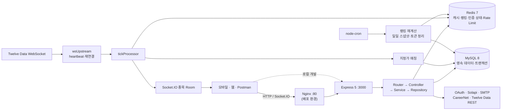

# Plain edu Backend

> 숏폼 학습, 미국 주식 모의투자, 팀 포트폴리오 의사결정, 리그와 커뮤니티를 하나의 계정 흐름으로 연결한 금융교육 백엔드입니다.

Plain edu는 금융 지식을 읽는 데서 끝내지 않고, **학습 → 판단 → 모의투자 → 회고**를 안전하게 반복하도록 만든 서비스입니다. 개인은 학습과 모의투자를 이어가고, 팀은 모델 포트폴리오(Model Portfolio, MP)를 제안·투표·운용하며 의사결정 과정을 연습합니다.

| 빠른 판단 항목 | 내용 |
|---|---|
| 해결하려는 문제 | 실제 돈을 쓰기 전에 금융 의사결정을 반복 연습할 환경이 부족하고, 학교 금융교육의 참여·성과가 지속적으로 남기 어렵다는 문제 |
| 핵심 기능 | 소셜 로그인과 인증, 숏폼·퀴즈, 미국 주식 시세·모의주문, 팀 MP·투표, 4종 랭킹, 커뮤니티 |
| 개인 기여 | 커뮤니티 기반, MP 생명주기와 전략 준수도, 마이페이지·대학 이메일 인증, DB 마이그레이션 도입, Twelve Data 사전 검증, Docker/Nginx/CD 초기 구성 |
| 검증 가능한 자료 | [OpenAPI](docs/openapi.yaml), [API 카탈로그](docs/api-catalog.md), [Postman 컬렉션](postman_collection.json), [기능명세서](<reference/Plain edu 기능명세서 v1.1.pdf>) |

> **기술 스택 안내**: 이 프로젝트는 Java/Spring이 아니라 **Node.js/Express**로 구현되었습니다. 이 README는 프레임워크 이름보다 도메인 계층 분리, 트랜잭션 경계, 데이터 정합성, 캐시, 외부 API 장애 대응, 테스트와 배포 자동화처럼 Java/Spring 백엔드에도 그대로 적용되는 설계 역량을 중심으로 설명합니다.

## 프로젝트가 해결하려는 문제

- 금융교육이 일회성 콘텐츠 소비로 끝나면 사용자가 실제 판단을 반복하거나 그 과정을 되돌아보기 어렵습니다.
- 개인 투자만으로는 협업 과정의 역할 분담, 제안, 투표, 실행 규율을 연습하기 어렵습니다.
- 학교·팀 단위 활동을 운영하려면 학습, 투자, 출석, 순위를 같은 사용자·시즌 모델 위에서 추적해야 합니다.
- 외부 시세 API는 호출량과 구독 종목이 제한되므로, 교육 서비스 규모에 맞는 캐시와 폴백 전략이 필요합니다.

이를 위해 개인 학습·모의투자와 팀 단위 자산운용 시뮬레이션을 한 서비스에 두고, 활동 데이터를 시즌 랭킹과 커뮤니티로 연결했습니다. 기획 배경과 전체 범위는 [기능명세서 v1.1](<reference/Plain edu 기능명세서 v1.1.pdf>)에서 확인할 수 있습니다.

## 핵심 기능

| 영역 | 현재 코드에서 확인되는 기능 |
|---|---|
| 인증·온보딩 | 카카오·네이버·구글 OAuth 코드 교환, Firebase ID Token 브리지, JWT Access Token, 해시된 Refresh Token 회전·재사용 감지, 휴대폰·대학교 이메일 인증, 약관 동의 |
| 학습 | 레벨별 주제, 숏폼 완료·좋아요·저장, 퀴즈 채점·완료, 응시 결과 스냅샷과 이력 |
| 시세·모의투자 | Twelve Data REST/WS 연동, 기간별 차트 캐시, 현재가 브로드캐스트, 관심종목, 시장가·지정가 주문, 틱 기반 지정가 체결 |
| 팀·포트폴리오 | 학교 단위 팀, 가입 신청·승인, 역할·규칙, MP Draft/Pending/Approved/Archived 생명주기, 팀원 투표, 전략 준수도(Alignment) |
| 리그 | 개인·팀·개인 소속·팀 소속 4종 순위, 장중 1분 재계산, 일일 자산·순위 스냅샷, 전일 대비 순위 변화 |
| 커뮤니티 | 커서 기반 게시글 피드, 종목 토론, 댓글·좋아요·스크랩·조회수·팔로우·알림, 인기 글·종목, 신고·차단·이용 제한·이의신청 |
| 운영 지원 | 관리자 API, OpenAPI/Swagger UI, QA 시드, DB 마이그레이션, Docker Compose, Nginx, GitHub Actions 배포 |

## 프로젝트 정보와 담당 역할

| 항목 | 저장소에서 확인한 내용 |
|---|---|
| 개발 기간 | 2026.04.29 ~ 2026.09.09 — 저장소의 최초·최종 커밋 날짜 기준 |
| 팀 구성 | 백엔드 저장소의 Git 작성자 별칭 기준 4명: `lee-mark01`, `jwonni`, `eun`, `kinn` |
| 개인 기여 식별 기준 | 현재 Git 사용자와 일치하는 `lee-mark01` 작성 커밋 23개(merge 제외, 두 이메일 별칭 합산) |
| 저장소 범위 | 백엔드 API와 데이터 파이프라인. 모바일·웹 프론트엔드는 포함하지 않음 |

### 내가 담당한 기능과 기여

팀 전체가 구현한 기능과 구분하기 위해 아래 표는 `lee-mark01` 작성 커밋에서 확인되는 범위만 적었습니다.

| 담당 영역 | 구현·판단 | 근거 |
|---|---|---|
| 백엔드 기반·DB | Express 도메인 골격, 공통 `AppError`, MySQL 초기 스키마를 구성하고 단일 `schema.sql` 관리에서 `db-migrate` 기반 변경 이력으로 전환 | `f7eba57`, `2cffa6c`, `593f011`; [db/migrations](db/migrations) |
| 커뮤니티 | 게시글 CRUD와 본인 인가, `id < cursor` 방식 페이지네이션, 제목·내용·작성자 검색, 댓글·대댓글, 좋아요·스크랩·조회수, 팔로우·알림, 인기 글·종목 집계를 구현 | `fb6d170` ~ `b53ce2a`; [community](src/domains/community) |
| 모델 포트폴리오 | MP 작성·제출·투표·활성화 상태 흐름, 구성 종목 일괄 저장, `ceil(팀원 수/2)` 가결 기준, 기존 Active MP 보관, 실제 보유 비중과 목표 비중의 Alignment 계산을 구현 | `cd5924a`; [portfolio.service.js](src/domains/portfolio/portfolio.service.js), [portfolio.alignment.js](src/domains/portfolio/portfolio.alignment.js) |
| 요구사항 정리 | 개별 매매 제안 기능을 코드·스키마·문서에서 함께 제거하고 관련 참조를 정리 | `1100158`; [remove-trade-proposals migration](db/migrations/20260724000001-remove-trade-proposals.js) |
| 사용자·학교 인증 | 마이페이지 통합 조회·수정·탈퇴·스크랩 목록과 Redis TTL 기반 대학교 이메일 인증을 구현 | `c161390`, `657369c`; [user.service.js](src/domains/user/user.service.js), [emailVerification.service.js](src/domains/auth/emailVerification.service.js) |
| 시세 기술 검증 | Twelve Data WebSocket의 연결·heartbeat·복수 구독·부분 실패·자산별 응답 차이를 실제 계정으로 검증하고 운영 이식 조건을 문서화 | `6ad1bd3`; [Spike 결과](spikes/twelvedata-ws-test/RESULT.md) |
| 배포 기반 | Node 애플리케이션, MySQL, Redis를 Docker Compose로 묶고 Nginx WebSocket 프록시와 GitHub Actions → EC2 SSH 배포의 초기 구성을 작성 | `bf739f2`, `d648b83`; [deploy.yml](.github/workflows/deploy.yml), [infrastructure.md](docs/infrastructure.md) |

## 시스템 아키텍처



### 주요 요청·데이터 흐름

1. **일반 API**: Router에서 JWT 인증과 Joi 검증을 수행하고 Controller → Service → Repository 계층을 거쳐 MySQL 또는 Redis에 접근합니다. 오류는 `AppError`와 공통 에러 미들웨어가 동일한 JSON 형식으로 변환합니다.
2. **차트 조회**: Redis의 `chart:{symbol}:{interval}`을 먼저 확인하고, 캐시 미스일 때만 Twelve Data REST를 호출합니다. 같은 키의 동시 미스는 프로세스 내 Promise를 공유해 중복 외부 호출을 줄입니다.
3. **실시간 시세·체결**: Twelve Data WS 틱을 `price:{symbol}`에 TTL과 함께 저장하고 Socket.IO room으로 전달합니다. 같은 틱이 지정가 주문 후보를 조회하며, 체결 시 주문 행 잠금과 계좌·보유·체결 로그 트랜잭션을 사용합니다.
4. **랭킹**: 미국 정규장 중 1분마다 계좌를 평가해 Redis Sorted Set 4종을 갱신합니다. 평일 16:05 ET에는 MySQL의 `DailyRankings`와 `AccountAssetHistories`에 일일 스냅샷을 남깁니다.

### 코드 구조

```text
src/
├─ domains/          # 도메인별 Router / Controller / Service / Repository / Validator
├─ marketData/       # 외부 WS, 동적 구독, 틱 처리, Socket.IO 게이트웨이
├─ jobs/             # 랭킹·스냅샷·토큰 정리 작업
├─ middlewares/      # 인증, 검증, 레이트리밋, 예외 처리
├─ config/           # DB, Redis, 시장 시간, 캐시·거래 정책
├─ app.js            # HTTP 라우팅과 Swagger UI
└─ server.js         # HTTP/Socket.IO 조립, 작업 시작, graceful shutdown

db/
├─ migrations/       # 26개 버전 마이그레이션과 up/down SQL
└─ seeds/            # 핵심 종목, 학습·QA·데모 데이터
```

## 기술 선택과 사용 목적

| 기술 | 이 프로젝트에서의 사용 목적 |
|---|---|
| Node.js 20, Express 5 | REST API와 Socket.IO를 한 HTTP 서버에 구성하고, I/O 중심의 외부 시세·DB 작업을 비동기로 처리 |
| MySQL 8, mysql2 | 사용자·팀·계좌·주문·포트폴리오의 관계와 FK/UNIQUE 제약을 관리하고, 주문 체결과 MP 상태 전이를 트랜잭션으로 처리 |
| db-migrate | 팀원이 같은 순서로 스키마 변경을 적용하고 배포 시 미적용 변경만 실행하도록 버전 관리 |
| Redis, ioredis | 차트·현재가 캐시, 실시간 랭킹 Sorted Set, OAuth state와 일회용 ticket, 인증번호 TTL, 분산 레이트리밋, 외부 API 사용량 기록 |
| ws, Socket.IO | Twelve Data 업스트림 연결과 클라이언트별 종목 room 구독을 분리해 실시간 현재가를 중계 |
| node-cron | 장중 랭킹 재계산, 보유 종목 구독 동기화, ET 기준 일일 스냅샷 실행 |
| Joi, jsonwebtoken | 요청 경계 검증과 JWT Access Token 인증. Refresh Token은 난수 원문 대신 SHA-256 해시와 계보를 DB에 저장 |
| OpenAPI 3, Swagger UI | 코드 라우트와 API 계약을 비교하고 `/api-docs`에서 호출 가능한 문서를 제공 |
| node:test | 계산기, 서비스, 라우팅·문서 계약, 장애·경계 조건을 의존성 주입과 실제 MySQL 통합 테스트로 검증 |
| Docker Compose, Nginx, GitHub Actions | 앱·MySQL·Redis 실행 환경 통일, HTTP/WS 리버스 프록시, main 브랜치의 EC2 배포 자동화 |

## 핵심 기술 문제 해결

### 1. MP 상태 전이에서 여러 테이블의 정합성 유지

**문제 상황**

MP 하나를 생성·수정할 때 `Portfolios`와 여러 `PortfolioAllocations`가 함께 바뀌고, 투표가 가결되면 투표 기록·찬반 수·상태·기존 Active 보관·새 Active 포인터가 한 번에 바뀌어야 했습니다. 중간 단계만 반영되면 화면의 상태와 실제 운용 기준이 달라집니다.

**선택과 구현**

생성·구성 교체·투표를 MySQL 트랜잭션으로 묶고 실패 시 rollback하도록 구현했습니다. 투표는 `(portfolio_id, voter_id)` UNIQUE 제약으로 1인 1표를 보강하고, 가결 시 기존 Active를 `ARCHIVED`로 바꾼 뒤 `TeamActivePortfolios`를 upsert합니다. 전략 평가는 DB 쓰기와 분리된 계산 함수에서 목표 비중, 보유 수량·현재가, 현금을 합산해 0~100 Alignment로 계산합니다. 저장소에는 대안 비교 기록이 없어 실제 선택된 방식만 기술합니다.

**검증 결과**

현재 서비스·저장소 코드에서 commit/rollback 경계와 UNIQUE 제약을 확인했습니다. 다만 현재 테스트 모음에는 MP 생명주기 전용 자동화 테스트가 없습니다.

**남은 한계**

투표 전 상태·중복 조회가 트랜잭션 밖에 있고 포트폴리오 행을 `FOR UPDATE`로 잠그지 않습니다. 서로 다른 PENDING 안건이 동시에 가결되는 경우까지 직렬화하지 않으므로, 팀 단위 잠금과 동시성 통합 테스트가 필요합니다.

### 2. 문서상 지원 범위가 아니라 실제 시세 공급자 응답으로 운영 조건 결정

**문제 상황**

Twelve Data 요금제 문서에 나온 심볼과 실제 계정에서 구독 가능한 심볼이 일치하지 않았고, 주식·외환·가상자산의 이벤트 필드도 달랐습니다. 문서만 믿고 전체 종목을 열면 런타임에서 부분 실패하거나 필드 누락으로 처리 파이프라인이 깨질 수 있었습니다.

**분석·검증**

2026-06-24에 별도 Spike로 연결, subscribe/unsubscribe/reset, heartbeat, 복수 심볼, 부분 실패를 확인했습니다. 같은 조건에서 BTC/USD는 30초간 30건, BTC/USD+EUR/USD는 30초간 합계 47건을 수신했고, 추가 가상자산·외환 후보 15개는 당시 Basic/Trial 계정에서 실패했습니다. 측정 조건과 원시 응답 예시는 [Spike 결과 문서](spikes/twelvedata-ws-test/RESULT.md)에 남겼습니다.

**선택과 구현 반영**

후보 종목을 먼저 실제 `subscribe-status.success/fails`로 확인한 뒤 거래 가능 목록을 구성하고, `exchange`, `day_volume` 같은 필드는 optional로 다루도록 정리했습니다. 현재 업스트림 코드는 이 결과를 근거로 부분 실패를 분리 기록하고 heartbeat·지수 백오프 재연결·현재 구독 집합 재전송을 수행합니다.

**남은 한계**

Spike 당시 미국 주식은 장외여서 AAPL의 실시간 가격 수신까지 확인하지 못했습니다. 현재의 3개 코어 심볼보다 구독 수를 늘렸을 때 틱 처리량과 외부 플랜 변경 영향도 측정되지 않았습니다.

### 3. 로컬 스키마부터 배포까지 같은 변경 순서로 재현

**문제 상황**

초기에는 큰 `schema.sql` 한 파일이 기준이라 팀원별 적용 상태를 추적하기 어려웠고, 앱·DB·Redis·WebSocket 프록시를 수동으로 맞춰야 했습니다.

**선택과 구현**

초기 스키마를 baseline migration으로 만들고 이후 변경을 timestamp 순서의 up/down 파일로 분리했습니다. 현재 26개 migration이 있으며, 핵심 미국 종목은 외부 API 없이도 멱등 시드됩니다. Docker Compose는 앱·MySQL·Redis, MySQL·Redis healthcheck와 영속 volume을 선언하고, Nginx는 WebSocket upgrade를 전달합니다. GitHub Actions는 계약 검사를 거친 뒤 EC2에서 이미지 빌드 → 컨테이너 기동 → migration/seed → `/api/health` 확인 순서로 실행됩니다.

**검증 결과**

현재 환경에서 `npm ci`, 전체 비-DB 테스트, OpenAPI 계약 검사를 실행했습니다. Docker CLI는 있었지만 Docker Desktop 엔진이 실행 중이지 않아 Compose 기동과 migration 재실행은 검증하지 못했습니다.

**남은 한계**

현재 배포는 단일 EC2에서 SSH와 `git pull`에 의존하며 자동 rollback·무중단 전환이 없습니다. 배포 workflow는 전체 테스트가 아니라 OpenAPI와 OAuth 일부 테스트만 gate로 사용하고, Docker는 Node 20·Actions는 Node 22라 런타임 버전도 일치하지 않습니다.

## 실행 방법

### 사전 조건

- Node.js 20 이상과 npm
- MySQL 8, Redis 7 또는 Docker Engine + Docker Compose
- 핵심 API 확인만 할 때 외부 서비스 키는 선택 사항입니다. 실시간 시세, OAuth, 문자·메일 인증, 학교 동기화에는 각 공급자 키가 필요합니다.

### 1. 환경 변수 준비

```bash
cp .env.example .env
```

Windows PowerShell에서는 다음 명령을 사용할 수 있습니다.

```powershell
Copy-Item .env.example .env
```

최소 로컬 설정 예시는 다음과 같습니다. 실제 비밀번호와 JWT secret은 직접 생성하고 저장소에 커밋하지 마세요.

```dotenv
DB_HOST=localhost
DB_PORT=3306
DB_USER=plainedu
DB_PASSWORD=<local-db-password>
DB_NAME=plainedu
REDIS_URL=redis://localhost:6379
JWT_ACCESS_SECRET=<long-random-secret>
PORT=3000
```

> 현재 Compose 구성은 `MYSQL_USER`에도 `DB_USER` 값을 전달합니다. Docker로 실행할 때는 `.env.example`의 `root` 대신 위 예시처럼 **root가 아닌 애플리케이션 사용자**를 지정해야 합니다.

| 기능 | 추가 환경 변수 |
|---|---|
| OAuth | `KAKAO_CLIENT_ID`, `KAKAO_CLIENT_SECRET`, `KAKAO_REDIRECT_URI`, 동일한 `NAVER_*`, `GOOGLE_*` |
| Firebase 브리지 | `FIREBASE_PROJECT_ID` |
| 시세·차트 | `TWELVEDATA_API_KEY`, 선택 `REALTIME_SYMBOLS`, `PRICE_TTL_SECONDS` |
| 대학 이메일 인증 | `SMTP_HOST`, `SMTP_PORT`, `SMTP_USER`, `SMTP_PASS` |
| 휴대폰 인증 | `SOLAPI_API_KEY`, `SOLAPI_API_SECRET`, `SOLAPI_SENDER_PHONE` |
| 학교 동기화 | `CAREERNET_API_KEY` |
| QA 로그인 | `MAIN_QA_AUTH_ENABLED`, `MAIN_QA_AUTH_PIN_HASH` — 공개 환경에서 임의 활성화 금지 |
| 운영 튜닝 | `INITIAL_CASH_INDIVIDUAL`, `INITIAL_CASH_TEAM`, `DEFAULT_SEASON_DURATION_DAYS`, `WS_MAX_VIEW_PER_SOCKET`, `WS_UNSUBSCRIBE_GRACE_MS`, `TWELVEDATA_*_BUDGET` |

`.env.example`의 `JWT_REFRESH_SECRET`, `JWT_REFRESH_EXPIRES_IN`은 현재 코드에서 읽지 않습니다. Refresh Token은 서명형 JWT가 아니라 난수 토큰을 발급해 해시로 저장합니다.

### 2-A. Docker Compose 실행

```bash
docker compose up -d --build
docker compose exec app npm run migrate
docker compose exec app npm run seed:users
docker compose exec app npm run seed:learning   # 선택: 학습 QA 데이터
curl http://localhost:3000/api/health
```

정상 헬스체크 응답:

```json
{"success":true,"message":"Server is running"}
```

### 2-B. 애플리케이션만 로컬 실행

MySQL과 Redis를 먼저 실행하고 `.env`의 접속 정보를 맞춘 뒤 진행합니다.

```bash
npm ci
npm run migrate
npm run dev       # nodemon
# 또는 npm start  # node src/server.js
```

- Swagger UI: <http://localhost:3000/api-docs>
- OpenAPI JSON: <http://localhost:3000/api-docs.json>
- Socket.IO: HTTP 서버와 같은 `3000` 포트

## 테스트와 검증

```bash
npm test
npm run check:openapi
```

- `npm test`는 37개 파일의 단위·서비스·계약·통합 테스트를 실행합니다.
- `tests/trading.executeFill.test.js`의 5건은 실제 MySQL 스키마, `seed:users`의 user id 5, migration에 포함된 AAPL이 필요한 통합 테스트입니다. 각 테스트는 트랜잭션 rollback으로 데이터를 되돌립니다.
- 이 README 작성 시점(2026-09-22)에 DB 통합 테스트를 제외한 **260건은 모두 통과**했습니다.
- 전체 명령은 총 265건 중 260건 통과, 5건 실패였습니다. 실패 원인은 테스트 assertion이 아니라 로컬 MySQL 자격 증명 미설정(`ER_ACCESS_DENIED_ERROR`)이며, 통합 테스트가 통과했다고 표현하지 않습니다.
- OpenAPI 검사는 `$ref` 721개와 전개 후 라우트 129개를 검사해 통과했습니다.

현재 개인 기여의 핵심인 MP 생명주기, 초기 커뮤니티 CRUD·상호작용, 대학 이메일 인증에는 직접 대응하는 자동화 테스트가 부족합니다.

## 문서와 검증 자료

| 자료 | 링크 | 비고 |
|---|---|---|
| 전체 API 계약 | [docs/openapi.yaml](docs/openapi.yaml) | 서버 기동 시 `/api-docs`로 렌더링 |
| API 목록·공통 규약 | [API 카탈로그](docs/api-catalog.md), [API 규약](docs/api-conventions.md) | 구현 경로 빠른 탐색 |
| Postman | [postman_collection.json](postman_collection.json) | 저장소에 포함된 호출 컬렉션 |
| MP·랭킹·시세 | [portfolio-api.md](docs/portfolio-api.md), [ranking-api.md](docs/ranking-api.md), [stock-chart.md](docs/stock-chart.md) | 상태 흐름·산식·캐시 계약 |
| 데이터 모델 | [erd.md](erd.md), [db/migrations](db/migrations) | `erd.md`는 초기 DDL 초안이며 현재 스키마의 단일 진실원천은 migration |
| 인프라·배포 | [infrastructure.md](docs/infrastructure.md), [deployment-guide.md](docs/deployment-guide.md) | 문서의 과거 공개 IP·포트 정책은 현재 운영값으로 간주하지 말 것 |
| 제품 명세 | [Plain edu 기능명세서 v1.1](<reference/Plain edu 기능명세서 v1.1.pdf>) | 기획 범위이며 현재 구현 완료 목록과 동일하지 않음 |
| 시세 검증 | [Twelve Data WS Spike](spikes/twelvedata-ws-test/RESULT.md) | 측정 시각·플랜·심볼·원시 응답 포함 |

## 현재 상태와 기술적 한계

- 저장소의 마지막 커밋은 2026-09-09입니다. 기능이 넓게 구현된 개발·QA 단계의 백엔드이며, 이 저장소만으로 프로덕션 준비 완료를 주장하지 않습니다.
- WebSocket 구독 집합과 스케줄러 실행 가드는 프로세스 메모리에 있습니다. 여러 앱 인스턴스를 띄우면 WS 연결과 cron이 중복되므로 Redis lock 또는 전용 worker가 필요합니다.
- 미국 시장 시간 판정은 ET 평일 09:30~16:00만 반영하고 공휴일을 알지 못합니다. 휴장일에도 일일 스냅샷이 실행될 수 있습니다.
- 로그는 `console` 기반이며 구조화 로그, 중앙 수집, metrics, tracing, alerting 설정이 없습니다. `/api/health`도 의존성 상태를 확인하지 않는 단순 liveness 응답입니다.
- Nginx 예시는 HTTP만 구성하고 CORS와 Socket.IO origin도 전체 허용입니다. 공개 배포 전 TLS, 허용 origin, 보안 그룹과 비밀 관리 재정비가 필요합니다.
- `npm audit --omit=dev` 결과 현재 운영 의존성에 취약점 8건(High 4, Moderate 2, Low 2)이 보고됩니다. 호환성 검증과 함께 의존성 업데이트가 필요합니다.
- 배포 workflow는 main push 후 단일 EC2를 갱신합니다. 전체 회귀 테스트, 이미지 registry, 롤백, blue/green 또는 rolling 배포는 없습니다.
- MP 투표의 가결 기준은 `ceil(팀원 수/2)`이므로 팀원이 짝수일 때 엄밀한 과반수를 보장하지 않습니다. 또한 Analyst 전용 작성 권한과 투표 마감·정족수 정책이 서비스 계층에서 강제되지 않습니다.
- 초기 ERD와 일부 문서는 후속 migration보다 오래되었습니다. 스키마 판단에는 `db/migrations`를 우선해야 하며, API 카탈로그의 Google browser callback 표기처럼 현재 라우트와 어긋난 항목도 별도 정리가 필요합니다.
